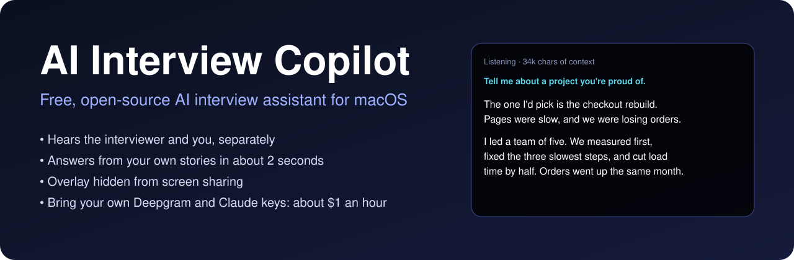

<p align="center"></p>

# AI Interview Copilot: free, open-source AI interview assistant for macOS

    

**AI Interview Copilot** is a free, open-source **real-time AI interview assistant** for macOS, and an open-source alternative to paid interview copilots such as Final Round AI, Cluely and LockedIn AI. It listens to your live interview on Zoom, Google Meet or Microsoft Teams, understands the interviewer's question, and shows you an answer in natural spoken sentences about two seconds later, built from your own résumé, stories and numbers.

Paid interview assistants charge a monthly subscription, in some cases up to around US$150 a month. This one is free. You bring your own [Deepgram](https://deepgram.com) and [Claude (Anthropic)](https://console.anthropic.com) API keys and pay those providers directly, typically about **US$1–2 per hour of interview**.

- **Free and open source** (MIT). No account, no subscription, no server: it runs on your Mac.
- **macOS only for now** (macOS 15 or later).
- **Bring your own API keys:** one for Deepgram (speech-to-text) and one for Claude (answers).
- **Tested** in mock interviews in English and Japanese on macOS 26. See [What has been tested](#what-has-been-tested).
- **Hidden overlay:** the answer window is excluded from screen sharing and screenshots.
- **Answers from your context, not invented:** it uses the stories and facts you give it and says so when it has none.

## Why people use it

| | Typical paid interview assistant | AI Interview Copilot |
|---|---|---|
| Price | Monthly subscription | Free; you pay API usage, about $1–2 an hour |
| Your data | Sent to the vendor's servers | Stays on your Mac; audio goes only to Deepgram, text only to Anthropic, under your own keys |
| Context | Résumé upload and a prompt box | Any number of your own files, sent whole on every question |
| Who is speaking | Often guessed from one audio stream | Interviewer and you captured as two separate streams |
| Source code | Closed | Open, about 600 lines of Swift you can read and change |
| Platforms | Usually Windows and macOS | macOS only for now |

## How it works

```
call audio (the interviewer) ─┐
                              ├─► Deepgram live transcription ─► Claude + your context ─► overlay
your microphone (you) ────────┘
```

- **Two separate audio streams.** System audio is the interviewer; the microphone is you. No voice guessing is needed to tell who said what.
- **Only the interviewer triggers an answer.** What you say is kept as conversation history, so follow-up questions make sense.
- **Background noise is ignored.** Microphone speech that is not English or Japanese is discarded.
- **Paused questions are merged.** If the interviewer stops and carries on within 8 seconds, both parts are answered as one question.
- **Your context is sent whole and cached**, so each question only waits on a few new tokens. Thinking is turned off for speed.
- **It stays quiet** on small talk, filler and half-finished questions.

Typical time from the end of a question to a complete answer is about two seconds with Claude Haiku.

## Requirements

- macOS 15 or later, with Xcode command line tools (Swift 6)
- A [Deepgram](https://deepgram.com) API key and an [Anthropic](https://console.anthropic.com) API key
- Headphones (on speakers, your microphone hears the interviewer too; the app filters this echo, but headphones are more reliable)

Running cost is roughly US$1–2 per hour of interview.

## Setup

```bash
git clone https://github.com/ManifestingBro360/ai-interview-copilot.git
cd ai-interview-copilot
./build.sh
```

Create the folder the app reads from, and copy the examples in:

```bash
mkdir -p ~/.interviewcopilot/context
cp examples/keys.example.json ~/.interviewcopilot/keys.json
cp examples/keyterms.txt ~/.interviewcopilot/
cp examples/context/*.md ~/.interviewcopilot/context/
chmod 600 ~/.interviewcopilot/keys.json
```

Then:

1. Put your two API keys in `~/.interviewcopilot/keys.json`.
2. Fill in the files in `~/.interviewcopilot/context/` (any `.md` or `.txt` file there is loaded).
3. List names and jargon the transcriber should recognise in `~/.interviewcopilot/keyterms.txt`, one per line.
4. Launch it with `open InterviewCopilot.app`.
5. Allow **Screen & System Audio Recording** and **Microphone** when macOS asks, then relaunch.

`build.sh` signs the app with an Apple Development certificate if you have one, so macOS remembers the permissions across rebuilds. Without one it falls back to ad-hoc signing and you may need to grant the permissions again after each rebuild.

## Interviews in a second language (Japanese)

If part of your interview is in Japanese and you are not fluent, the app can keep you to answers you have rehearsed.

- Put your approved answers, in romaji, in a context file with `japanese` in its name (see `examples/context/08-japanese-romaji.md`). Follow each sentence with an `(EN: ...)` line giving its meaning.
- For a Japanese question the overlay shows an English translation of the question, your approved sentences, and their English meaning.
- The app shows **only sentences from that file**. Anything the model composes or rewords is replaced by the closest approved sentence or dropped, because improvised Japanese can contain wrong words you cannot check live.
- If nothing approved fits, it shows your "I'll answer in English" line followed by an English answer.
- Files with `japanese` in the name are sent only for Japanese questions, so English questions stay fast.
- Optional: `"japanese": "romaji" | "hiragana" | "both"` in `keys.json`, with a `japanese-kana.tsv` file (romaji, tab, kana) next to it, if you prefer to read kana.

## How it stays fast

- **Early start:** when the live transcript already looks like a finished question, answering begins before the pause that confirms it.
- **Cached context:** your context is cached by the model provider and refreshed every 4 minutes, so no question pays a cold start.
- **No thinking step**, and a small fast model by default.
- First words typically appear 1.5 to 2 seconds after the interviewer stops speaking.

## Writing good context

The quality of the answers depends almost entirely on these files.

- **Write facts, not adjectives.** Real numbers, dates, team sizes, product names.
- **Write stories** as situation, action, result, lesson, and say which kinds of question each one answers.
- **List what you have not done.** The app will then say so plainly and bridge to what you have done.
- **Give exact lines for sensitive topics** such as salary, why you left, or anything confidential.
- **Leave gaps visible.** Where you give no details, the app outlines a general approach and marks it `(check)`.

## Files

| Path | What it is |
|---|---|
| `Sources/AudioCapture.swift` | System audio and microphone capture (ScreenCaptureKit), converted to 16 kHz PCM |
| `Sources/Deepgram.swift` | Streaming transcription and end-of-question detection |
| `Sources/Claude.swift` | Streaming answers with the context cached |
| `Sources/Config.swift` | Loads keys and context; the answer-style instructions live here |
| `Sources/main.swift` | The overlay window and the conversation logic |
| `~/.interviewcopilot/log.txt` | What was heard and answered. The overlay cannot be screenshotted, so this is how you review a session |

Set `"model"` in `keys.json` to a larger Claude model for richer answers at some cost in speed.

## What has been tested

- **Works:** hearing the interviewer and the candidate separately; answering in about two seconds; follow-up questions; questions split by a pause; English and Japanese; a voice assistant acting as the interviewer; AirPods and built-in speakers.
- **Verified:** the overlay does not appear in macOS screenshots (`screencapture`).
- **Not yet verified by the author:** the overlay during a live screen share in Zoom, Google Meet or Teams. Test this yourself before relying on it; the steps are under [Limits](#limits).

## Limits

- The overlay uses the standard macOS window setting that excludes it from capture. Test it with your own meeting app before relying on it: start a call, join from a second device, share your entire screen, and check the overlay is missing.
- macOS shows its own recording indicator in your menu bar while the app listens.
- Background voices near your microphone get transcribed as you.
- The answer on screen can change once if the interviewer adds to a question after you have started reading.

## Use it responsibly

Many employers do not allow live assistance in interviews, and some check for it. Whether and where to use this is your decision and your risk. It is also useful, without that risk, for rehearsing: point a voice assistant at it as a mock interviewer and practise your own stories until you no longer need the screen.

## FAQ

**Is AI Interview Copilot really free?**
Yes. The app is free and open source under the MIT licence. You pay Deepgram and Anthropic directly for what you use, usually about US$1–2 per hour of interview.

**Which API keys do I need?**
Two: a Deepgram API key for live speech-to-text, and an Anthropic API key for Claude, which writes the answers. Both go in a local file on your Mac.

**Does it work on Windows or Linux?**
Not yet. It is macOS only (macOS 15 or later), because it uses Apple's ScreenCaptureKit for audio capture and a native window that is excluded from screen capture.

**Does it work with Zoom, Google Meet and Microsoft Teams?**
It captures whatever audio your Mac plays, so it works with any meeting app, in the browser or as a desktop app.

**Can the interviewer see the overlay when I share my screen?**
The window is marked as excluded from screen capture, and it does not appear in macOS screenshots. Meeting apps differ, so check with your own app before you rely on it.

**Is it an alternative to paid AI interview copilots?**
It covers the core of what they do: live transcription, question detection and answers from your own context in real time. It does not include mock-interview libraries, coding-problem solvers or résumé builders.

**What languages does it support?**
Transcription is multilingual. It has been tested in English and Japanese, and answers in the language the interviewer uses.

**Can I use it just to practise?**
Yes, and it is very good for that. Run a voice assistant as a mock interviewer on the same Mac and rehearse your own stories.

## Licence

MIT
